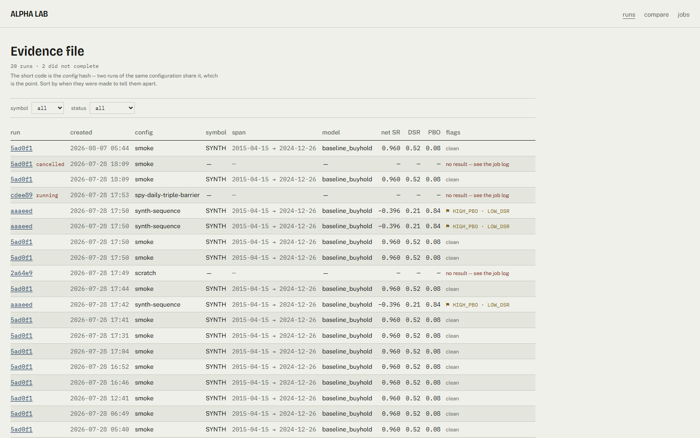
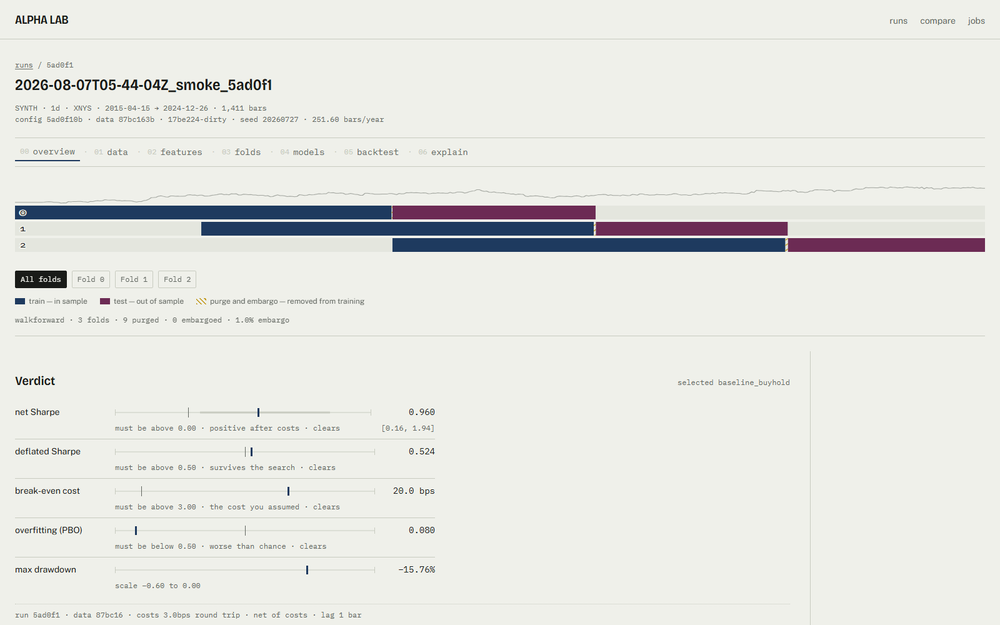

<h1 align="center">Alpha Lab</h1>

<p align="center">
  <em>A research platform that tries to talk you out of your trading edge.</em>
</p>

<p align="center">
  <a href="https://github.com/errorlessak/alpha-lab/actions/workflows/ci.yml"></a>
  <a href="LICENSE"></a>
  
  
  
</p>

---

Alpha Lab decides whether a claimed short-horizon predictive signal on
financial time series is **real** — meaning it survives purged validation,
transaction costs, and multiple-testing correction.

It deliberately refuses to trade. There is no broker connectivity, no order
routing, and no recommendation of any kind. The system reports evidence; the
judgement stays with the researcher.



## Try it in one command

```bash
docker compose up --build
```

Then open <http://127.0.0.1:8000>. The first start produces a complete run from
a committed synthetic fixture — about ten seconds, no network, no credentials —
so the index has something in it before you have configured anything.

Prefer to run it locally? [Skip to the local setup](#local-setup).

## Why it exists

Almost any short-horizon backtest can be made to look good. The usual failures
are well known and individually boring: same-bar execution, scaling before
splitting, global quantile labels, zero costs, reporting the best of forty
models without a haircut. Together they produce a Sharpe ratio that means
nothing.

Alpha Lab treats each of those failures as an invariant to enforce and a test to
enforce it with. The headline number is never presented alone: it comes with a
bootstrap confidence interval, a deflated Sharpe haircut carrying the actual
trial count, the probability of backtest overfitting, and the round-trip cost in
basis points at which the edge disappears.

**Some of those invariants are enforced rather than documented.** A feature that
names a label column as an input cannot be registered. Quantile label edges
cannot be fitted without an explicit training mask. Correlation pruning cannot
run on the full sample. Every cross-validation fold is purged and embargoed
before it is handed back, and `train_test_split` and plain `KFold` fail the
build if they appear in library code. Every leaderboard carries a
shuffled-label row, so there is always a scale on the axis. The backtester
cannot execute on the bar that produced its signal — orders are queued against a
strictly later bar, and `execution_lag_bars: 0` raises. **Each of these raises
rather than warns.**

Two tests guard the last one, and they only mean anything together: a perfect
close-of-bar predictor must earn nothing, and a model handed the actual forward
return must earn an absurd amount. Without the second, an engine that simply
never made money would pass the first.

> The most valuable output this repository can produce is a run where the model
> does **not** find an edge, reported honestly, with the diagnostics that prove
> the pipeline would have detected one if it existed.

[**docs/methodology.md**](docs/methodology.md) is the full argument — what each
stage defends against, and what the metrics mean.

## What a good result looks like

On the committed fixture — a seeded random walk with no predictable structure —
the leaderboard is topped by `baseline_buyhold` at a net Sharpe of 0.960, whose
deflated Sharpe of 0.52 barely clears the line once the six configurations tried
are accounted for. Every model that actually predicts something is flagged
`LOW_DSR` and lands below zero, including a logistic regression with an
information-coefficient t-statistic of 3.46 — statistically detectable,
economically worthless. The shuffled-label baseline sits at the bottom where it
belongs, and PBO is 0.08.

**That is the pipeline working.** There is no edge in a random walk, and a run
that claimed one would mean something upstream is leaking.



The hero is the **Fold Strip**: one lane per walk-forward fold, prussian for
train, hatched sulphur for the purge and embargo, plum for test. It is
simultaneously the chart, the global fold filter, and the honest disclosure of
exactly how the model was validated.

Below it, headline metrics are **tolerance rails** rather than big numbers —
each shows the estimate, its confidence interval, and the line it has to clear.
A deflated Sharpe of 0.524 against a 0.5 threshold *looks* like what it is.

Every plate carries a provenance stamp, so no chart can be screenshotted out of
context and misread. The right margin is generated from the tearsheet and argues
with the page. The index is a ledger, not a dashboard: failed runs stay in it,
because a research index that hides its failures is a highlight reel.

---

## Local setup

Requires [uv](https://docs.astral.sh/uv/) and [just](https://just.systems/).

```bash
just setup
```

That installs the library, the web app's packages and the Playwright browser.
It deliberately leaves out the optional extras, because `import alphacore` must
work without any of them:

| Extra | Brings | Needed for |
|---|---|---|
| `gbm` | LightGBM, XGBoost, CatBoost | the `lightgbm`, `xgboost`, `catboost` candidates, the shuffled-label baseline, and TreeSHAP |
| `dl` | PyTorch (~120 MB download) | the `lstm`, `lstm_stacked`, `bilstm`, `gru`, `tcn` and `ensemble_gbm_lstm` candidates |
| `tune` | Optuna | `models.tuning.enabled: true` |

`just setup-dl` installs all three. Without them, a config naming a model you
have not installed fails with a message naming the extra rather than a
traceback, and the tests that need one skip rather than fail. **Nothing above is
needed for the smoke config.**

```bash
uv run alpha doctor
```

Reports whether this machine can produce reproducible runs — the interpreter
version, whether `PYTHONHASHSEED` is pinned, and the versions of every package
that can change a result.

### Run the whole thing

```bash
uv run alpha run -c configs/experiments/smoke.yaml
```

Ingest, features, labels, purged folds, every candidate and every mandatory
baseline scored out of fold, a costed backtest of each, the honesty metrics, and
a written research note — about ten seconds, entirely offline. It leaves a run
directory under `runs/`:

```
runs/{run_id}/
├── tearsheet.json      # the canonical result; the API and UI read nothing else
├── manifest.json       # config hash, data hash, code revision, seed, timings
├── config.resolved.yaml  quality.json  features.json  folds.json
├── equity.parquet  drawdown.parquet  rolling_sharpe.parquet
├── trades.parquet  predictions.parquet  ledger.parquet
├── leaderboard.csv  metrics.csv
├── research.md         # the tearsheet as prose, caveats first
├── models/{model}/model.pkl
└── logs.jsonl
```

The run directory is written once and never modified. Producing a different
result means producing a new run.

```bash
uv run alpha runs list
uv run alpha runs show <run-id>
uv run alpha runs compare <run-id> <run-id>
```

`compare` puts two runs side by side and says so explicitly when they share a
config hash — at which point any difference between them came from the data or
the code, not the configuration.

Individual stages print rather than write: `alpha features build`, `alpha train`
and `alpha backtest` each take the same `-c <config>` and stop where their name
says. **Only `alpha run` produces a run directory.**

### Ingest some data

The smoke config runs entirely offline, from a committed synthetic fixture:

```bash
uv run alpha data pull -c configs/experiments/smoke.yaml
uv run alpha data inspect --dataset csv:SYNTH:1d
```

`inspect` prints the catalog row — including the `content_hash` a run pins
itself to — and the quality report: bars present against bars the NYSE calendar
says should exist, longest consecutive gap, duplicates, zero-volume bars, OHLC
violations, and return outliers.

To pull real data instead:

```bash
uv run alpha data pull -c configs/experiments/spy_daily_tb.yaml
```

That one needs the network and returns twenty years of daily SPY from Yahoo. It
reports quality `WARN` rather than `PASS` and says why — a dozen returns with a
robust z-score above 10, and bars that fall outside the XNYS session grid. **The
warnings are the point**: real data is never clean, and the run records that it
was let through.

### The experiment configs

| Config | Data | Notes |
|---|---|---|
| `smoke.yaml` | committed fixture, offline | Ten seconds. Three candidates plus the baselines. What CI runs. |
| `synth_sequence.yaml` | committed fixture, offline | An LSTM, a GRU and the GBM-plus-LSTM ensemble. Needs the `dl` extra; about half a minute. |
| `spy_daily_tb.yaml` | Yahoo, network | Twenty years of SPY, six candidates, **tuning on with 60 trials per model**. Roughly an hour: each trial runs the whole inner walk-forward and a costed backtest. Set `models.tuning.enabled: false` if you only want a leaderboard. |
| `btc_1h_meta.yaml` | Binance — **not implemented** | Committed to pin the crypto calendar contract. `alpha data pull` on it fails with a message naming the gap rather than substituting another provider. |

### Serve it

```bash
just serve
```

The API on `127.0.0.1:8000`, with interactive documentation at
[`/api/v1/docs`](http://127.0.0.1:8000/api/v1/docs). It reads the artifact store
and never writes to it — runs are created by jobs and never modified afterwards.

```bash
curl -s localhost:8000/api/v1/runs | jq '.runs[0]'
```

```bash
curl -s -X POST localhost:8000/api/v1/jobs \
  -H 'content-type: application/json' \
  -d '{"type":"full_run","config_ref":"configs/experiments/smoke.yaml"}'
```

Submitting a job returns `202` and a `Location`. Follow the run live:

```bash
curl -N localhost:8000/api/v1/jobs/<job-id>/events
```

That is a server-sent event stream of log lines, structured progress, and one
terminal status frame. It resumes from `Last-Event-ID` if the connection drops.

Series are downsampled server-side to the pixel width you ask for, so a
hundred-thousand-point equity curve arrives as the twelve hundred points a chart
can actually draw:

```bash
curl -s "localhost:8000/api/v1/runs/<run-id>/series/equity?width=1200"
```

Errors are RFC 9457 problem documents that name the cause and the fix rather
than "something went wrong". **The service has no authentication** and can start
jobs, so it binds loopback by default — see [SECURITY.md](SECURITY.md) before
exposing it.

```bash
just client
```

Regenerates `docs/openapi.json` and the TypeScript client in
`web/src/api/generated/`. Both are committed, and CI fails if they drift from
the routes.

### Look at it

```bash
just serve                 # terminal one
npm --prefix web run dev   # terminal two
```

The app on <http://localhost:5173>, reading the API on 8000. To serve the
production bundle from a single origin the way the container does — no Vite, no
proxy:

```bash
just serve-bundled
```

### Sequence models

```bash
just setup-dl
uv run alpha run -c configs/experiments/synth_sequence.yaml
```

Five architectures — a single LSTM, a stacked LSTM, a bidirectional LSTM, a GRU
and a small dilated TCN — plus `ensemble_gbm_lstm`, which averages a LightGBM's
calibrated probabilities with an LSTM's. They go on the same leaderboard as
everything else, against the same mandatory baselines, ranked by the same
economic score.

The interesting part is the window. A fold's training rows arrive already
purged, so the frame has a hole in it where the test block was, and a rolling
window laid over that frame positionally would weld the two sides of the hole
together — a model reading bars from after the test period while training on
bars from before it, in a fold whose metadata is entirely correct. Windows here
are cut on positions in the complete bar index, never across a gap
([ADR 0011](docs/decisions/0011-sequence-windows-are-cut-on-the-bar-grid.md)),
and `tests/leakage/test_window_purge.py` proves it against a control that
implements the obvious version and fails the same assertion.

---

## The gate

```bash
just verify
```

Format, lint, both type checkers, the full test suite with an 85% coverage
floor, the leakage suite, an end-to-end smoke run, the Playwright golden path
and the bundle budget. **Nothing is done until it is green.** CI runs the same
things across six jobs, plus a Docker build and a check that every generated
file is current.

| | |
|---|---|
| Python tests | 1,100+, 89% coverage on `alphacore` |
| Leakage suite | 75 tests, all seven §12.3 canaries with controls |
| Types | mypy `strict` on 105 files, `tsc --noEmit` on the app |
| Initial JS | 99 KB gzipped against a 200 KB budget |
| Lighthouse | 95 / 100 / 100, median of three, on a store holding one run |

That last row is measured rather than aspirational, and it is worth one
sentence of honesty: the performance score falls on a store holding dozens of
runs, because the index grows after its fetch lands and the resulting layout
shift is charged against it. Accessibility is 100 in both light and dark mode,
and the end-to-end suite now computes the contrast ratio of every piece of text
on the page in both schemes rather than trusting the palette.

## Documentation

| | |
|---|---|
| [docs/methodology.md](docs/methodology.md) | **Start here.** What the pipeline defends against and what the metrics mean. |
| [docs/diagrams.md](docs/diagrams.md) | Layering, the run directory, the job lifecycle, the container. |
| [ARCHITECTURE.md](ARCHITECTURE.md) | The build specification. The contract. |
| [PROGRESS.md](PROGRESS.md) | Build log — what is done, what was deferred, what surprised us. |
| [HANDOFF.md](HANDOFF.md) | Environment traps, load-bearing conventions, known gaps. Read before changing anything. |
| [docs/data-dictionary.md](docs/data-dictionary.md) | Every feature: inputs, parameters, warm-up cost. Generated from the registry. |
| [docs/decisions/](docs/decisions/) | ADRs. Every deviation from a naïve stack, with its trade-off. |
| [docs/openapi.json](docs/openapi.json) | The API contract. The TypeScript client is generated from it. |
| [docs/design-plan.md](docs/design-plan.md) | The web app's design: tokens, layout, wireframes, and the self-critique. |
| [CONTRIBUTING.md](CONTRIBUTING.md) · [SECURITY.md](SECURITY.md) · [CHANGELOG.md](CHANGELOG.md) | |

## Limitations

Stated here rather than discovered later. [HANDOFF.md](HANDOFF.md) §8 has the
full list.

- **No authentication anywhere.** Deliberate for a single-user local tool, and
  the reason the service binds loopback. See [SECURITY.md](SECURITY.md).
- **The backtest engine is single-symbol.** A config naming more than one
  symbol raises rather than silently trading the first.
- **Jobs do not survive an API restart.** Nothing resumes them.
- **`fill_price: next_vwap` is accepted by the config and not implemented** —
  the engine always fills at the open.
- **The `binance` and `alphavantage` providers are not implemented.**
  Requesting one raises a message naming the gap rather than falling back.
- **The DSR implementation is pinned by an independent transcription of the
  formula, not by the paper's worked example.** That catches an implementation
  error but not a misreading. Stated in full in [PROGRESS.md](PROGRESS.md).

## Licence

[MIT](LICENSE).

## Disclaimer

Research software, not investment advice. Backtested performance is not
indicative of anything. See [DISCLAIMER.md](DISCLAIMER.md).
