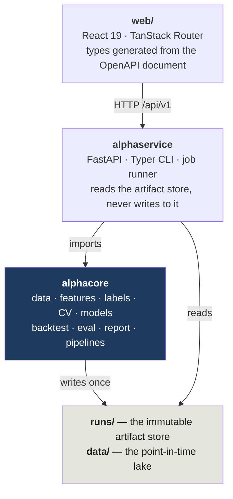
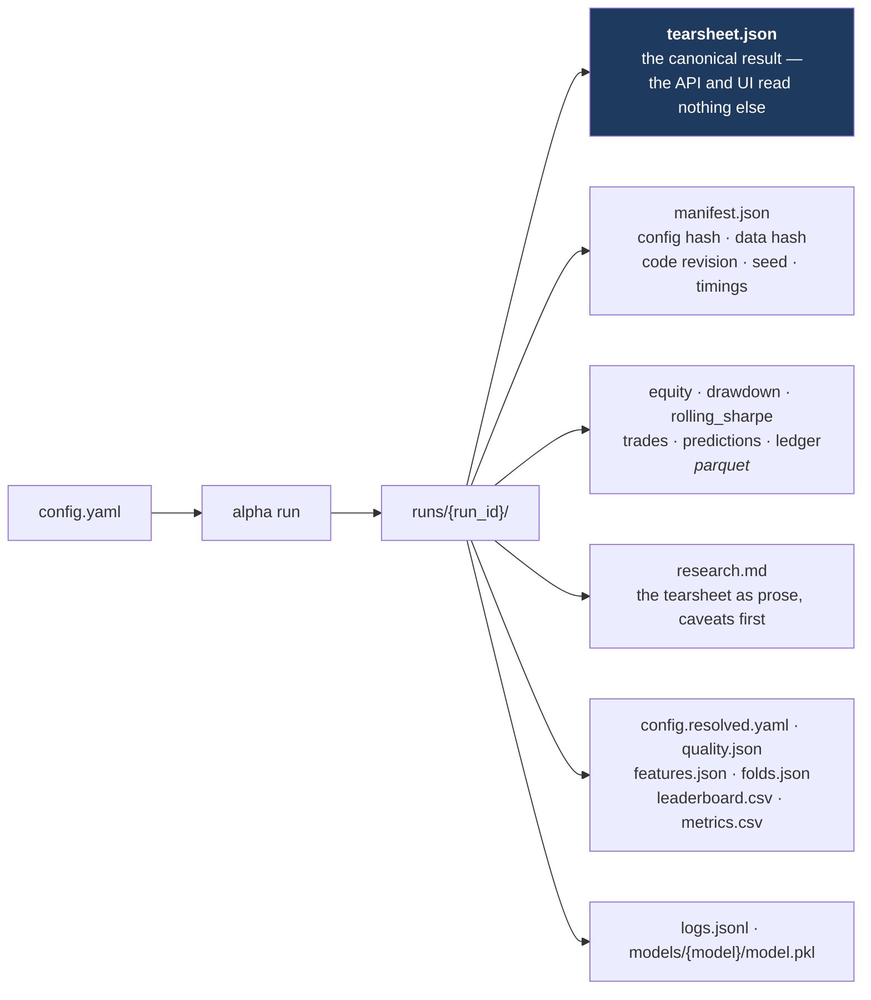
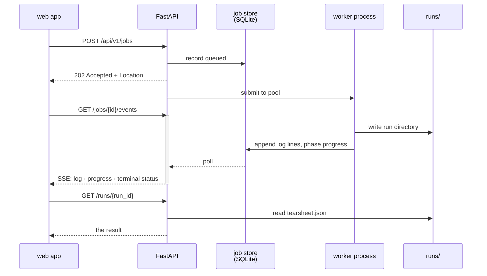
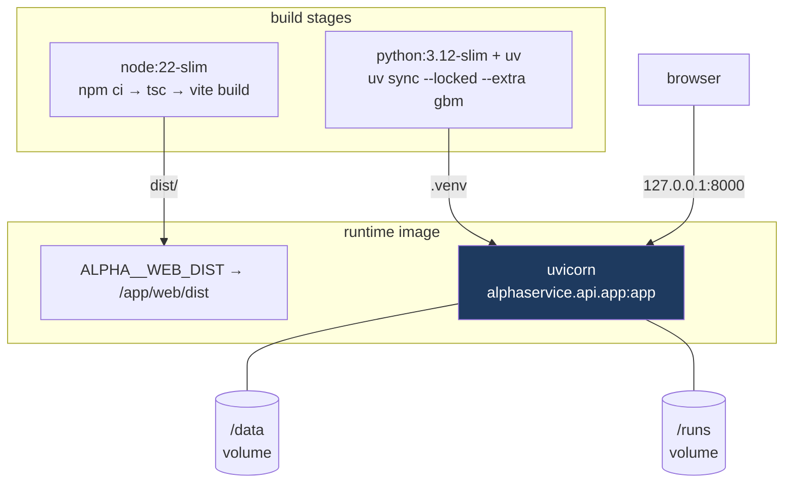

# Architecture diagrams

Four views of the system, rendered by GitHub from their source. They are
Mermaid rather than exported images on purpose: a diagram that has to be
re-exported to stay true is a diagram that stops being true.

For what the pipeline *means* rather than how it is wired, read
[methodology.md](methodology.md). For the full specification, read
[ARCHITECTURE.md](../ARCHITECTURE.md).

---

## 1. Layering

Dependencies run one way and only one way. The contract is enforced by
import-linter in `pyproject.toml` and checked by `just lint`, so a violation
turns the build red rather than becoming a convention nobody can undo later.

`alphacore` never imports FastAPI, Starlette, uvicorn, Typer or Click — a second
import-linter contract says so. It is a research library that happens to have a
service in front of it, not a web application with some statistics inside.

---

## 2. What a run produces

`alpha run` is the only verb that writes a run directory. The stage verbs
(`features build`, `train`, `backtest`) run the pipeline up to that point and
print what they found, because a directory holding `features.json` and no
`tearsheet.json` would satisfy §16's filenames without satisfying its meaning.

The directory is written once and never modified (§4, I9). Producing a
different result means producing a new run — which is why `alpha runs compare`
can say, when two runs share a config hash, that any difference between them
came from the data or the code rather than the configuration.

---

## 3. Submitting a job

The API creates runs through an in-process job runner
([ADR 0008](decisions/0008-in-process-job-runner.md)) rather than a queue and a
broker. One user, one machine, and a dependency on Redis that would exist only
to move a JSON blob three inches.

The stream resumes from `Last-Event-ID` if the connection drops, and ends with
exactly one terminal status frame. Cancellation is cooperative: a cancel lands
at the next phase boundary, so the run directory is finalised rather than killed
mid-write.

**Jobs do not survive an API restart.** Nothing resumes them, and the run
directory will not claim to be `completed`. That is a documented limitation, not
a bug to be discovered.

---

## 4. The container

One image, one process, one origin. The web client requests `/api/v1/…` with no
host, so the bundle and the API have to answer on the same origin — which is
also why the CORS allow-list names only the Vite dev server rather than `*`.

In development none of this applies: Vite serves the app on 5173 and proxies
`/api` to `just serve` on 8000, and the static mount is inert unless
`ALPHA__WEB_DIST` is set.

The image carries the `gbm` extra and not `dl` — LightGBM, XGBoost and CatBoost
are what the baselines and TreeSHAP need, while torch adds about 2 GB for a
model family no packaged config uses. `--build-arg EXTRAS="--extra gbm --extra
dl"` puts it in.
