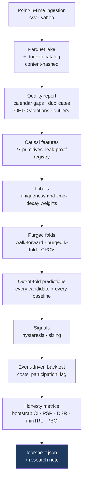
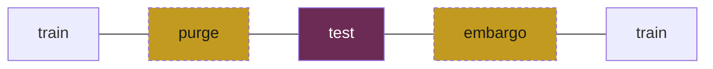

# Methodology

*Why you should believe a number this system produces — and the specific
reasons you should not believe most others.*

This document is for a reader who has not read
[ARCHITECTURE.md](../ARCHITECTURE.md). It explains what the pipeline does, in
order, and what each step is defending against. Section numbers in parentheses
point at the specification if you want the full statement of a rule.

---

## 1. The problem

Almost any short-horizon backtest can be made to look good. That is not a
provocation, it is arithmetic: a researcher with a few hundred configurations, a
free choice of period, and no cost model will find a Sharpe ratio of 2 in pure
noise, and will find it quickly.

The failures that produce those numbers are individually well known and
individually boring:

| The mistake | What it does |
|---|---|
| Same-bar execution | Trades on the bar that produced the signal — a look-ahead of exactly one bar, worth more than any real edge |
| Scaling before splitting | The scaler's mean and variance carry information from the test period into training |
| Global quantile labels | Label thresholds fitted on the whole sample encode the future's distribution |
| Overlapping labels, unweighted | Ten consecutive samples share nine bars of price path; the effective sample size is inflated tenfold |
| Unpurged folds | A label spanning the fold boundary is resolved by bars the model is about to be tested on |
| Zero costs | Turns a signal worth 3 bps into a strategy worth 30 |
| Best-of-N reporting | The maximum of forty noisy Sharpe ratios is high *by construction* |

Alpha Lab treats each of these as an **invariant to enforce and a test to
enforce it with** (§4, §12.3). Most of them raise rather than warn:

- A feature that names a label column as an input **cannot be registered**.
- Quantile label edges **cannot be fitted** without an explicit training mask.
- Correlation pruning **cannot run** on the full sample.
- `execution_lag_bars: 0` **raises**. Orders are queued against a strictly
  later bar.
- `train_test_split` and plain `KFold` **fail the build** if they appear in
  library code — checked by parsing the AST, because a text search also matches
  the docstrings explaining the ban.
- A metric that cannot be computed **raises** rather than returning `NaN`
  (§0.7). A silent NaN in a Sharpe ratio is a critical bug.

---

## 2. The pipeline



Every stage is a module under `packages/alphacore/src/alphacore/`, and every
stage is reachable on its own from the CLI. Only `alpha run` writes a run
directory — a directory with `features.json` and no `tearsheet.json` would
satisfy §16's filenames without satisfying its meaning.

---

## 3. Data, and knowing what you had

Bars are ingested **point in time** into a parquet lake, and the dataset is
content-hashed. A run pins itself to that hash, so "the data changed" is a
detectable event rather than an unexplained difference between two runs.

Before anything is computed, the dataset is scored against the exchange
calendar: bars present against bars the calendar says should exist, longest
consecutive gap, duplicates, zero-volume bars, OHLC violations, and return
outliers by robust z-score.

Real data never passes cleanly. Twenty years of daily SPY reports `WARN`, with
a dozen returns above a robust z of 10 and bars outside the XNYS session grid.
**The warnings are the point**: the run records that it was let through, and the
tearsheet carries the flag.

---

## 4. Features that cannot see forward

Every primitive is causal by construction — it reads bar `t` and earlier, never
later. The registry enforces two things that are easy to get wrong by accident:

- **A feature cannot name a label column as an input.** Registration raises.
- **Every feature declares its warm-up cost**, so the number of unusable
  leading rows is a fact in the data dictionary rather than a surprise.

Correlation pruning — dropping one of each pair of features above a threshold —
is a fitting step. It cannot be run on the full sample; it takes a training
mask, and refuses without one.

The full list, with inputs, parameters and warm-up, is generated from the
registry into [data-dictionary.md](data-dictionary.md).

---

## 5. Labels, and why they are not independent

Four labelling methods: `horizon_sign`, `horizon_return`, `horizon_quantile`,
and `triple_barrier`. Triple-barrier emits `{-1, 0, +1}` and models here are
binary, so reduction to two classes is a **required, visible step**
(`labels.to_binary(..., method="direction" | "touch")`) rather than something
that happens silently.

The subtler problem is that labels overlap. A label spanning `[t, t+10]` on
daily bars shares nine bars of price path with the label at `t+1`. Left alone,
that inflates the effective sample size roughly tenfold — which makes every
standard error too small, every significance test too generous, and every
fitted model too confident.

Two corrections, multiplied together (§8.2):

- **Uniqueness.** For a label spanning `[t_start, t_end]`, average `1/c_u` over
  the bars `u` in its span, where `c_u` counts how many labels are live at `u`.
  A label sharing every bar with nine others contributes a tenth as much.
- **Time decay.** Linear in cumulative uniqueness, from `decay` at the oldest
  observation to `1.0` at the newest. Markets change; a 2007 observation is
  evidence about 2007.

---

## 6. Purged cross-validation



One fold, laid out in time. The two hatched blocks are removed from training
and used by nothing.

Three schemes — walk-forward, purged k-fold, and combinatorial purged CV — and
all three apply the same two removals before handing a fold back (§9):

**Purge.** A label whose span overlaps the test window is dropped from
training. Without this, the model trains on a label whose outcome is determined
by bars it is about to be tested on. With a ten-bar horizon, ten training
samples on each side of every test block are contaminated.

**Embargo.** A further `embargo_pct` of bars immediately *after* the test window
is dropped from training. Purging handles labels that overlap; the embargo
handles serial correlation that outlives the label. Features are built from
trailing windows, so a training sample starting one bar after the test block
still shares most of its inputs with it.

**Neither is optional.** §4 (I4) is explicit, and no scheme exposes a way to
turn purging off. The exact purged and embargoed indices are carried alongside
the counts, which is what lets the Fold Strip in the web app draw the gaps that
were actually used rather than gaps it inferred.

### The sequence-model trap

A fold's training rows arrive **already purged**, so the frame has a hole in it
where the test block was. A rolling window laid over that frame *positionally*
welds the two sides of the hole together — a model reading bars from after the
test period while training on bars from before it, in a fold whose metadata is
entirely correct.

Windows here are cut on positions in the complete bar index, never across a
gap, and a sequence model raises rather than guessing if it was not told what
that index is ([ADR 0011](decisions/0011-sequence-windows-are-cut-on-the-bar-grid.md)).
`tests/leakage/test_window_purge.py` proves it against a control that implements
the obvious version and fails the same assertion.

---

## 7. Baselines, and the scale on the axis

A Sharpe ratio of 0.9 means nothing without knowing what 0.9 is worth on this
data. Every leaderboard therefore carries **mandatory baselines**, scored the
same way, out of the same folds, through the same cost model:

| Baseline | What it tells you |
|---|---|
| `baseline_buyhold` | The return you get for doing nothing |
| `baseline_always_long` | Buy-and-hold with the strategy's own sizing and costs |
| `baseline_momentum` | A rule with no fitting at all |
| `baseline_random_sign` | Seeded coin flips |
| `baseline_shuffled` | **The same estimator trained on shuffled labels** |

The last is the important one. `baseline_shuffled` destroys the relationship
between features and labels while keeping everything else — the same model, the
same folds, the same weights, the same costs. Whatever it scores is what this
pipeline produces from *nothing*. A model that beats it by less than that
margin has found nothing.

Ranking is by an **economic** objective, not by AUC
([ADR 0007](decisions/0007-economic-leaderboard.md)). A model can be
statistically detectable and economically worthless, and the leaderboard is
built to show exactly that: the smoke run's logistic regression has an
information coefficient t-statistic of 3.46 and a net Sharpe below zero.

---

## 8. Execution and costs

The backtester is event-driven and its cost model is one readable page (§12.2):

```
cost_per_share = commission_bps/1e4 · price
               + half_spread_bps/1e4 · price
               + impact(price, qty, adv)

impact_sqrt    = coefficient · price · σ · √(qty / adv)
impact_linear  = coefficient · price · (qty / adv)
```

plus `max(min_commission, …)` per trade, borrow accrued daily on short
notional, and financing on leveraged long notional.

**Participation is capped.** An order larger than `max_participation ×
bar_volume` is partially filled. Silently filling 100% of a bar's volume at the
open is a fantasy the engine does not permit.

**Costs are never zero by default.** A frictionless configuration is legitimate
as a diagnostic, and it is what the reference cross-check runs under — but
`is_frictionless` makes it detectable, so the run is flagged `UNCOSTED` (I10).

**The engine cannot execute on the bar that produced its signal.** Orders are
queued against a strictly later bar and `execution_lag_bars: 0` raises. Two
tests guard this, and they only mean anything together:

1. A **perfect close-of-bar predictor must earn nothing.**
2. A model handed the **actual forward return must earn an absurd amount.**

Without the second, an engine that simply never made money would pass the
first.

---

## 9. The honesty metrics

The headline number is never presented alone. Five things travel with it (§11.2,
§11.3).

### Bootstrap confidence interval

A **stationary block bootstrap**, with the block length chosen from the series'
own autocorrelation by the Politis–White rule rather than picked by hand.

Blocks, not individual observations: resampling returns one at a time destroys
the serial dependence financial returns actually have — volatility clusters, and
overlapping labels make consecutive observations share a price path. An i.i.d.
bootstrap on that data produces an interval far too narrow, which is the
opposite of what a confidence interval is for.

### Probabilistic Sharpe ratio

The probability the true Sharpe exceeds a benchmark, adjusting for skew and
kurtosis:

```
PSR(SR*) = Φ( (SR − SR*)·√(n−1) / √(1 − γ₃·SR + ((γ₄−1)/4)·SR²) )
```

Negative skew and fat tails both *lower* it, which is right: a strategy that
usually makes a little and occasionally loses a lot has a Sharpe that overstates
it.

### Deflated Sharpe ratio

PSR evaluated at the Sharpe you would expect from the **best of N tries on pure
noise**:

```
SR* = √Var[SR_n] · [ (1−γ)·Φ⁻¹(1 − 1/N) + γ·Φ⁻¹(1 − 1/(N·e)) ],   γ = 0.5772…
```

Search sixty configurations and the best of them has a good Sharpe by
construction. DSR asks whether it is good enough to survive that fact.

**`N` is taken from the run**, not typed in — the Optuna study reports its own
trial count (§10.4). A hand-entered trial count is self-deception.

### Minimum track record length

How many observations you would need for a Sharpe to be significant at 95%.
Usually a longer history than anyone has, which is the useful part.

### Probability of backtest overfitting

PBO answers a different question from the others: not *"is this strategy
good?"* but **"is my selection process better than picking at random?"**

By combinatorially symmetric cross-validation: split the out-of-sample return
matrix into `S` contiguous chunks; for each of the `C(S, S/2)` ways of dividing
them into a training half and a testing half, pick the configuration with the
best in-sample Sharpe and find where it ranks out of sample. PBO is the
fraction of splits where the in-sample winner lands below the out-of-sample
median.

**`PBO > 0.5` means the selection procedure is worse than a coin flip**, and the
UI is required to say that in plain language rather than printing a number and
moving on.

Contiguous chunks, not random ones: preserving the time ordering is what makes
a financial backtest a backtest.

### And the one that is not a statistic

**Break-even cost.** The round-trip cost in basis points at which the edge
disappears. It converts an abstract argument about significance into a question
anyone can answer: *is my broker cheaper than that?*

---

## 10. Reproducibility

A result nobody can reproduce is not evidence (§4, I8).

- `PYTHONHASHSEED` is pinned, and `alpha doctor` fails if it is not.
- Every RNG is seeded through `deterministic_rng(seed, *stream_labels)`.
- Every gradient booster runs with `n_jobs=1`.
- All serialisation is canonical JSON with sorted keys.
- Sequence models train on **CPU unless a device is named**
  ([ADR 0012](decisions/0012-sequence-models-train-on-cpu-by-default.md)):
  accelerator reductions are not bit-reproducible, and a run that quietly picked
  a GPU would produce artifacts nobody else can reproduce while still claiming
  they were deterministic.
- Every annualisation is explicit. `periods_per_year` is a required argument
  derived from the calendar and recorded in the manifest. 252 is never
  hardcoded.

The same config run twice produces a **byte-identical tearsheet** — including
with an LSTM in the candidate list. Run directories are written once and never
modified; producing a different result means producing a new run.

---

## 11. What a good result looks like

On the committed fixture — a seeded random walk with no predictable structure —
the leaderboard is topped by `baseline_buyhold` at a net Sharpe of 0.960, whose
deflated Sharpe of 0.52 barely clears the line once the six configurations tried
are accounted for. Every model that actually predicts something is flagged
`LOW_DSR` and lands below zero, including a logistic regression with an IC
t-statistic of 3.46. The shuffled-label baseline sits at the bottom where it
belongs, and PBO is 0.08.

**That is the pipeline working.** There is no edge in a random walk, and a run
that claimed one would mean something upstream is leaking.

The most valuable output this repository can produce is a run where the model
does **not** find an edge, reported honestly, with the diagnostics that prove
the pipeline would have detected one if it existed (§19).

---

## 12. What this does not do

Stated plainly, because a methodology document that only lists strengths is
marketing.

- **It does not trade.** No broker connectivity, no order routing, no
  recommendation. The system reports evidence; the judgement stays with the
  researcher.
- **The backtester is single-symbol.** A config naming more than one symbol
  raises rather than silently trading the first.
- **`fill_price: next_vwap` is accepted by the config and not implemented** —
  the engine always fills at the open.
- **Clustered mean-decrease-accuracy and reliability diagrams are not built.**
- **The DSR implementation is checked against an independent transcription of
  the formula, not against the paper's worked example.** That catches an
  implementation error but not a misreading of the formula. See
  [PROGRESS.md](../PROGRESS.md) for the full statement of this substitution.
- **The trade blotter counts a partial reduction as a completed trade.** Each
  row is one realising event with its own entry price and P&L, so `n_trades`
  under `vol_target` sizing counts realisations, not round trips.
- **Cross-validation cannot make a small sample large.** Purging, embargoing
  and honest costs remove false confidence; they do not create evidence that
  the data does not contain.

---

## Sources

The statistical methods implemented here follow the literature on backtest
overfitting and financial machine learning — in particular the probabilistic
and deflated Sharpe ratios, the CSCV procedure for the probability of backtest
overfitting, purging and embargoing, and uniqueness-based sample weighting for
overlapping labels. Each implementation carries the formula it transcribes in
its docstring; check them there, against the module rather than against this
summary.

---

*Research software. Not investment advice. Backtested performance is not
indicative of anything. See [DISCLAIMER.md](../DISCLAIMER.md).*
